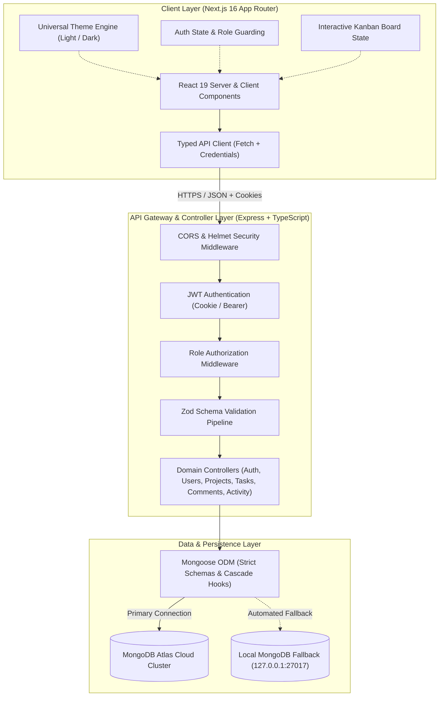
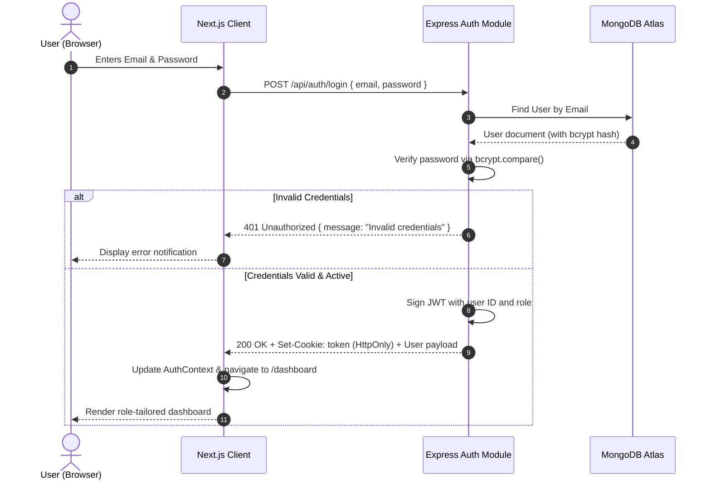
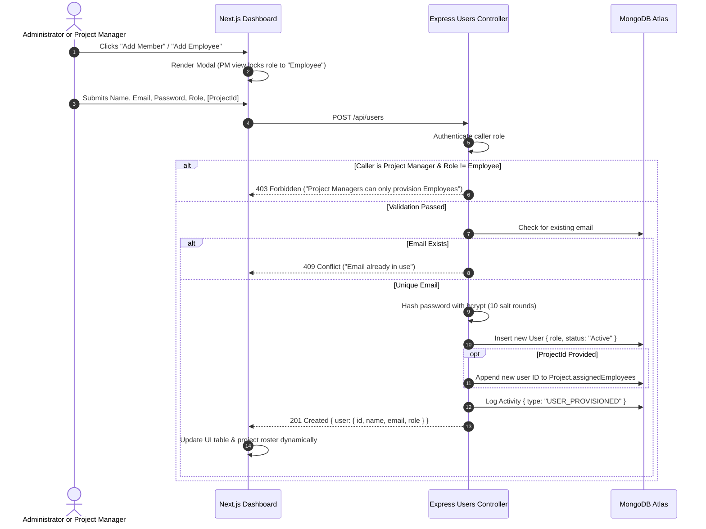
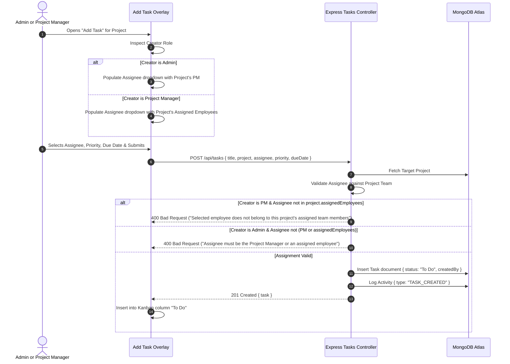
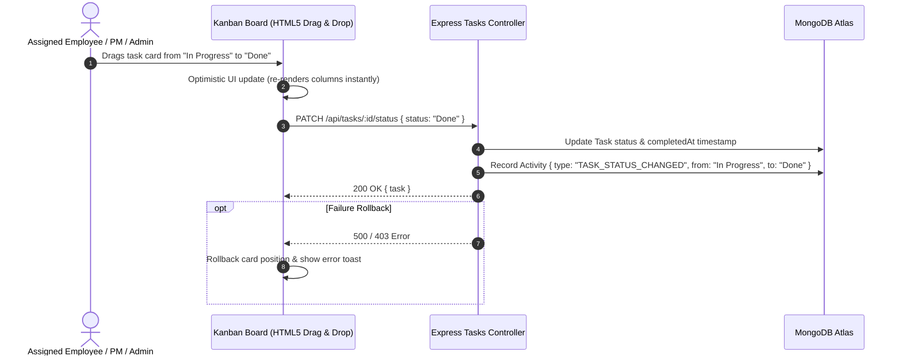
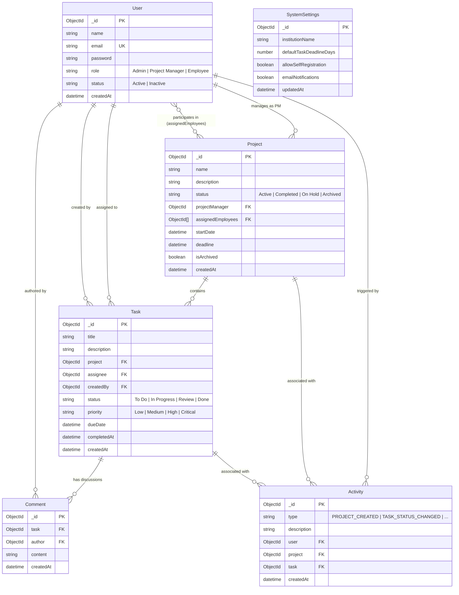

# ICSR Advanced Project Management System — System Architecture

This document provides a comprehensive architectural overview of the ICSR Technical Assignment Project Management System. It details the system topology, multi-tier role-based access control (RBAC), sequence workflows, data models, theme engine, and institutional security mechanisms.

---

## 1. High-Level System Topology

The ICSR Project Management System is structured as a decoupled, multi-tier enterprise web application comprising a modern Next.js 16 frontend, an Express.js TypeScript REST API backend, and a cloud-native MongoDB database with automated local failover.



---

## 2. Multi-Tier Role-Based Access Control (RBAC) Architecture

Security and isolation are implemented with a **defense-in-depth** strategy across three distinct layers:

```
[Layer 1: Frontend Route & Component Guards]
                 ↓
[Layer 2: API Route Authorization Middleware]
                 ↓
[Layer 3: Controller-Level Resource Ownership Enforcement]
```

### 1. Layer 1: Frontend Route & UI Guards
* **Navigation Filtering**: The sidebar and top navigation dynamically filter accessible menus based on the authenticated user's role (`user.role`).
* **Route Protection**: Protected views check the active session. Unauthorized roles attempting to access higher-privilege pages (such as `/settings` or `/team` with unauthorized role escalation) are redirected.
* **Component-Level Conditional Rendering**: Action controls (e.g., "Add Member", "Add Project", "Delete Project", "Assign to PM") only render if the authenticated user possesses explicit authority.

### 2. Layer 2: API Route Authorization Middleware
* Express route endpoints invoke `authenticate` to decode and verify signed JWTs from `req.cookies.token` or `Authorization: Bearer`.
* Routes chain `authorize("Admin")` or `authorize("Admin", "Project Manager")`. Any role outside the permitted whitelist is terminated with `403 Forbidden` before controller execution.

### 3. Layer 3: Controller-Level Resource Ownership Isolation
* Even when an authenticated Project Manager or Employee makes an authorized request, controllers verify resource ownership:
  * **Project Manager**: May only read, update, or archive projects where `project.projectManager.equals(user._id)`.
  * **Employee**: May only access projects and tasks where they are explicitly enumerated in `assignedEmployees` or `task.assignee`.
  * **Role Mutation Lockdown**: Project Managers are barred from elevating users to `Admin` or `Project Manager` (enforced at the controller level with HTTP 403).

---

## 3. Core Operational Workflows

### Workflow 1: Authentication & Session Lifecycle

Public registration is disabled. Users authenticate using enterprise credentials issued by system administrators.



---

### Workflow 2: Role-Governed User Provisioning

To prevent rogue account creation, user provisioning is restricted to Administrators and Project Managers under strict role constraints.



---

### Workflow 3: Dual-Mode Task Assignment & Delegation

Task assignment enforces distinct responsibilities between executive administrators and project managers:



---

### Workflow 4: Interactive Kanban State Transitions



---

## 4. Universal Theme Engine Architecture

The application implements a zero-FOUC (Flash of Unstyled Content), persistent light and dark theme engine tailored for dense, data-rich SaaS dashboards.

### Design Principles & Defaults
* **Default Theme**: **Light Mode** is the institutional default across all login, authentication, and dashboard pages.
* **Tailwind CSS v4 Configuration**: Configured with `@custom-variant dark (&:where(.dark, .dark *));` in `client/src/app/globals.css`.
* **Synchronous Anti-FOUC Script**: An inline script executes in `<head>` before DOM hydration, reading `localStorage.getItem("icsr_theme")` and applying the `.dark` class to `document.documentElement` if explicitly set to dark.
* **Component-Level React Context**: `ThemeProvider` exposes `theme` ("light" | "dark") and `toggleTheme()` to provide seamless toggle controls in the Topbar, Login view, and Settings page.

```mermaid
flowchart LR
    BrowserLoad["Page Load"] --> AntiFOUC["Inline Script in &lt;head&gt;"]
    AntiFOUC --> ReadStorage{"Check localStorage.icsr_theme"}
    ReadStorage -->|"dark"| AddDarkClass["Add .dark class to &lt;html&gt;"]
    ReadStorage -->|"light" or null (default)| SetLight["Ensure no .dark class (Default: Light)"]
    AddDarkClass --> Hydrate["React 19 Hydrates ThemeProvider"]
    SetLight --> Hydrate
    Hydrate --> UserToggle["User Clicks Theme Switcher"]
    UserToggle --> UpdateContext["Toggle Theme in React State"]
    UpdateContext --> SaveStorage["Persist choice to localStorage"]
    UpdateContext --> ToggleDOMClass["Add/Remove .dark on &lt;html&gt;"]
```

---

## 5. Database Schema & Entity Relationships

The data model is built using Mongoose schemas over MongoDB with explicit relationship integrity:



---

## 6. Security Architecture & Threat Mitigation

| Security Concern | Implementation & Mitigation |
|---|---|
| **Credential Theft** | Passwords salted and hashed with `bcryptjs` (work factor: 10 rounds). Passwords never returned in API payloads (`select("-password")`). |
| **Token Hijacking & XSS** | JWTs transmitted via `HttpOnly`, `SameSite=Lax` cookies to prevent client-side JavaScript access. In production, `Secure` flag enforces HTTPS. |
| **Header Injection & Clickjacking** | Helmet middleware injects OWASP-recommended HTTP security headers: `X-Frame-Options: DENY`, `X-Content-Type-Options: nosniff`, `Strict-Transport-Security`. |
| **Cross-Origin Abuse** | Express CORS configured strictly with `origin: CLIENT_URL` (whitelisted) and `credentials: true`. Wildcards (`*`) are disallowed. |
| **Payload Injection & Tampering** | Incoming request payloads undergo runtime validation via Zod schemas (`auth.validator.ts`, `task.validator.ts`, `comment.validator.ts`) prior to controller logic. |
| **Unauthorized Privilege Escalation** | Multi-layer authorization checks prevent non-admins from modifying user roles or account statuses. Public registration disabled. |
| **Data Integrity on Deletion** | Project deletion employs transactional or cascade cleanup logic to purge associated tasks, discussions, and activity records. |
